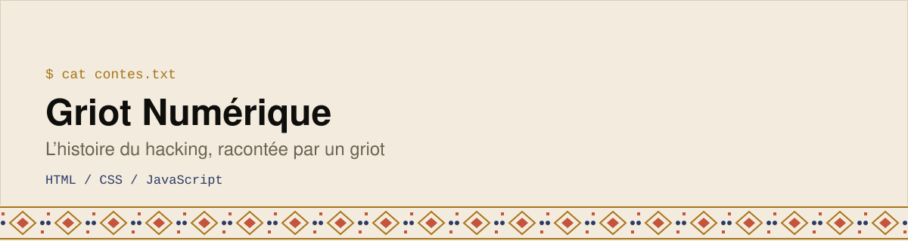

  <picture>
    <source media="(prefers-color-scheme: dark)" srcset="assets/banner-dark.svg">
    
  </picture>

*Les Chroniques des Maîtres de Code* : l’histoire du hacking racontée comme le ferait un **griot**, le conteur et gardien de la mémoire en Afrique de l’Ouest.

   

## L’idée
Rendre l’histoire de la cybersécurité accessible en reprenant la forme du conte : une préface du griot, puis 6 contes qui suivent l’histoire du hacking (des premiers explorateurs aux phreakers, aux premiers « royaumes numériques », à l’arrivée du web, jusqu’aux rançonneurs et aux défenseurs).

## Voir le projet
Ouvre [`le commencement.html`](./le%20commencement.html) dans ton navigateur. C’est une page unique, sans installation.

## Pourquoi ce projet
Il rapproche deux univers : la **culture orale d’Afrique de l’Ouest** et la **cybersécurité**, expliquées *en clair*.

---

Construit par **Emmanuel Elisé Koné** ([BinaryMaoGenius](https://github.com/BinaryMaoGenius)) · *La tech en clair*
